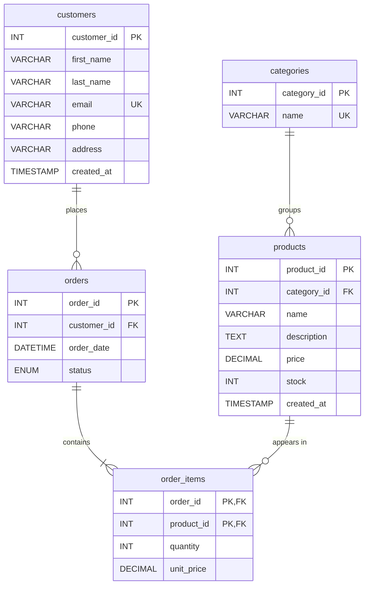

# SQL Labs: University Students and Online Store

A set of three MySQL lab scripts for learning SQL, from basic `SELECT` filtering to a complete relational database with constraints, a trigger, a view and a least-privilege user.

| File | Topic | Database | Level |
|------|-------|----------|-------|
| [`Lab_one.sql`](Lab_one.sql) | Selecting and filtering data | `University` | Beginner |
| [`Lab_two.sql`](Lab_two.sql) | Designing a full relational database | `online_store` | Intermediate |
| [`lab_three.sql`](lab_three.sql) | `DISTINCT`, arithmetic, `NOT IN`, `LIKE` | `University` (typo, see [Known issues](#known-issues)) | Beginner |

---

## Table of contents

1. [Requirements](#requirements)
2. [Getting started](#getting-started)
3. [Lab one: Filtering the `students` table](#lab-one-filtering-the-students-table)
4. [Lab two: The `online_store` database](#lab-two-the-online_store-database)
5. [Lab three: Distinct values, arithmetic and pattern matching](#lab-three-distinct-values-arithmetic-and-pattern-matching)
6. [Known issues](#known-issues)
7. [Suggested practice](#suggested-practice)
8. [Security notes](#security-notes)

---

## Requirements

- **MySQL 8.0.16 or later** (or a compatible MariaDB release). Version 8.0.16+ is needed because `Lab_two.sql` uses `CHECK` constraints, which older MySQL versions parse but ignore.
- A MySQL client: the `mysql` command line, MySQL Workbench, DBeaver, or phpMyAdmin.
- An account that can create databases (for example `root`). `Lab_two.sql` also creates a user and grants privileges, so it needs the `CREATE USER` and `GRANT OPTION` privileges.

## Getting started

Run a script from the terminal:

```bash
mysql -u root -p < Lab_one.sql
mysql -u root -p < Lab_two.sql
```

Or open a file in MySQL Workbench or DBeaver and run it statement by statement. This is the better way to learn, because you can read each result before moving on.

> **Warning:** `Lab_two.sql` begins with `DROP DATABASE IF EXISTS online_store;`. This permanently deletes any existing database with that name. Do not run it against data you want to keep.

---

## Lab one: Filtering the `students` table

**File:** `Lab_one.sql` | **Database:** `University`

Creates a `students` table with 10 sample students and practises the core of `SELECT`.

### Table structure

| Column | Type | Notes |
|--------|------|-------|
| `student_id` | `INT` | Primary key |
| `student_name` | `VARCHAR(100)` | |
| `gender` | `VARCHAR(10)` | `Male` or `Female` |
| `programme` | `VARCHAR(50)` | `BSIT`, `DIT` or `BSE` |
| `year_of_study` | `INT` | 1 to 3 |
| `age` | `INT` | |
| `marks` | `INT` | |
| `town` | `VARCHAR(50)` | Mukono, Kampala, Jinja, Entebbe, Gulu |

### Concepts covered

| Concept | Example |
|---------|---------|
| Create and use a database | `CREATE DATABASE University; USE University;` |
| Inspect a table's structure | `SELECT ... FROM information_schema.columns WHERE table_name = 'students';` |
| Choose columns | `SELECT student_name, programme, marks FROM students;` |
| Filter rows | `WHERE programme = 'BSIT'` |
| Comparison operators | `>`, `>=`, `!=`, `<>` |
| Combine conditions | `AND`, `OR`, and brackets to control evaluation order |
| Match a list | `town IN ('Mukono', 'Kampala')` |
| Match a range (inclusive) | `marks BETWEEN 60 AND 80` |
| Sort results | `ORDER BY marks DESC` |

### Example

```sql
-- Mukono students who are struggling, or Jinja students who are excelling
SELECT * FROM students
WHERE (town = 'Mukono' AND marks < 60)
   OR (town = 'Jinja' AND marks > 80);
```

### Reflection questions

The file ends with three reflection answers about the hardest challenge, mistakes made (unquoted text values, and `BETWEEN` being inclusive), and a real-world use of filtering data.

Key lessons recorded there:

- Use **brackets** when mixing `AND` and `OR`, so the query means what you intend.
- **Text values need quotes** (`'BSIT'`, not `BSIT`).
- **`BETWEEN` includes both ends**, so `BETWEEN 60 AND 80` returns 60 and 80 too.

---

## Lab two: The `online_store` database

**File:** `Lab_two.sql` | **Database:** `online_store`

A complete, self-contained schema for a small e-commerce store, with sample data and example queries. This script can be re-run from scratch at any time.

### Entity relationship diagram



### Tables

| Table | Purpose | Key rules |
|-------|---------|-----------|
| `customers` | People who buy from the store | `email` is required and unique |
| `categories` | Product groups | `name` is unique |
| `products` | Items for sale | `price >= 0` (`CHECK`); `stock` cannot go negative (`UNSIGNED`); indexed on `name` |
| `orders` | One row per order | `status` is one of `pending`, `paid`, `shipped`, `delivered`, `cancelled`; indexed on customer and date |
| `order_items` | Products inside an order (many-to-many link) | Composite primary key `(order_id, product_id)`; `quantity > 0` (`CHECK`) |

### Referential integrity

| Foreign key | On update | On delete | Effect |
|-------------|-----------|-----------|--------|
| `products.category_id` to `categories` | `CASCADE` | `RESTRICT` | Cannot delete a category that still has products |
| `orders.customer_id` to `customers` | `CASCADE` | `RESTRICT` | Cannot delete a customer who has orders |
| `order_items.order_id` to `orders` | `CASCADE` | `CASCADE` | Deleting an order removes its line items |
| `order_items.product_id` to `products` | `CASCADE` | `RESTRICT` | Cannot delete a product that has been ordered |

### Trigger: `trg_reduce_stock`

Fires **after each insert** on `order_items` and subtracts the ordered quantity from `products.stock`. Because `stock` is `UNSIGNED`, an order for more than the available stock makes the subtraction fail (in strict SQL mode), so the insert is rejected and overselling is prevented.

> The script uses `DELIMITER //` so the trigger body can contain semicolons. This is a client command, so it works in the `mysql` CLI and MySQL Workbench but may need to be removed in tools that handle delimiters themselves.

### View: `order_totals`

Joins `orders`, `customers` and `order_items` to show one row per order with the customer's full name, date, status and computed `total` (`SUM(quantity * unit_price)`).

```sql
SELECT * FROM order_totals;
```

### Sample data

- 3 customers, 3 categories, 4 products, 2 orders and 3 order lines.
- After the script runs, stock reflects the sample orders (for example, Wireless Mouse falls from 50 to 48).
- Prices are in whole units of local currency (for example `25000.00`).

### Application user

```sql
CREATE USER IF NOT EXISTS 'store_app'@'localhost' IDENTIFIED BY 'ChangeMe_123!';
GRANT SELECT, INSERT, UPDATE, DELETE ON online_store.* TO 'store_app'@'localhost';
```

This follows the **principle of least privilege**: the application can read and change data but cannot alter the schema (no `DROP`, `ALTER` or `CREATE`). **Change the password before any real use.**

### Example queries included

| Query | Shows |
|-------|-------|
| `SELECT * FROM order_totals;` | All orders with totals |
| `SELECT name, stock FROM products WHERE stock < 25;` | Products low on stock |
| `JOIN` + `SUM` + `GROUP BY` + `ORDER BY units_sold DESC` | Best-selling products |
| `UPDATE orders SET status = 'shipped' WHERE order_id = 1;` | Changing an order's status |

### Backup

Run in the operating-system terminal, not inside MySQL:

```bash
mysqldump -u root -p online_store > online_store_backup.sql
```

---

## Lab three: Distinct values, arithmetic and pattern matching

**File:** `lab_three.sql` | **Database:** intended to be `University`

Recreates the same `students` table and data as Lab one, then practises:

| Concept | Statement in the file |
|---------|-----------------------|
| Unique values | `SELECT DISTINCT ... FROM students;` |
| Arithmetic with an alias | `SELECT marks + 4 AS increment_marks FROM students;` |
| Arithmetic with an alias | `SELECT age - 5 AS rightful_age FROM students;` |
| Range filter | `WHERE age BETWEEN 23 AND 60` |
| Exclusion list | `NOT IN (...)` |
| Pattern matching | `LIKE 'k%'`, `LIKE 'a%'`, `LIKE '%an%'` |

### Known issues

Several statements in this file do not do what they were written to do. They run without an error in most cases, which makes them easy to miss. The corrected versions are below.

| # | Problem in the file | Why it is wrong | Corrected statement |
|---|---------------------|-----------------|---------------------|
| 1 | `create database Universit;` | Typo: the database created is `Universit`, but the next line runs `use University;`. Alone, this fails with "Unknown database"; after Lab one, it silently uses the old database. | `CREATE DATABASE IF NOT EXISTS University;` |
| 2 | `SELECT DISTINCT 'towns' FROM students;` | Single quotes make `'towns'` a **text literal**, so it returns the word "towns" once, not the towns. | `SELECT DISTINCT town FROM students;` |
| 3 | `WHERE 'towns' NOT IN ('Kampala, Entebbe')` | The column is `town` (no quotes), and `'Kampala, Entebbe'` is **one string**, not two values. | `WHERE town NOT IN ('Kampala', 'Entebbe')` |
| 4 | `WHERE 'towns' like 'k%'` | Compares a literal, not a column. It returns nothing. | `WHERE town LIKE 'K%'` |
| 5 | `WHERE 'name' like 'a%'` and `'%an%'` | There is no column called `name`; the column is `student_name`. The quotes also make it a literal. | `WHERE student_name LIKE 'A%'` and `WHERE student_name LIKE '%an%'` |
| 6 | Running Lab three after Lab one | `CREATE TABLE students` fails because the table already exists, so the data is not inserted twice. | Add `DROP TABLE IF EXISTS students;` before `CREATE TABLE`, or run Lab three in a fresh database. |

**Remember:** single quotes (`'...'`) create text values; column names take **no quotes** (or backticks if needed).

Corrected block:

```sql
CREATE DATABASE IF NOT EXISTS University;
USE University;

SELECT DISTINCT town FROM students;
SELECT marks + 4 AS increment_marks FROM students;
SELECT age - 5 AS rightful_age FROM students;
SELECT * FROM students WHERE age BETWEEN 23 AND 60;
SELECT * FROM students WHERE town NOT IN ('Kampala', 'Entebbe');
SELECT * FROM students WHERE town LIKE 'K%';
SELECT * FROM students WHERE student_name LIKE 'A%';
SELECT * FROM students WHERE student_name LIKE '%an%';
```

### Other notes

- `Lab_one.sql` repeats a few queries (`WHERE programme = 'BSIT'` appears twice, and `!=` and `<>` are equivalent). This is deliberate practice, not a mistake.
- `Lab_one.sql` and `lab_three.sql` both start with `CREATE TABLE students`, so run only one of them per fresh database, or add `DROP TABLE IF EXISTS students;`.

---

## Suggested practice

**After Lab one**

1. List students in year 3 sorted by name.
2. Find female students in `DIT` with marks above 80.
3. Show students who are not from Mukono and scored between 50 and 75.

**After Lab two**

1. Show each customer and the number of orders they have placed (`LEFT JOIN` + `COUNT`).
2. List products that have never been ordered.
3. Add a new order with an item, and check that stock decreases.
4. Try to order more than the stock available and observe the error.
5. Try to delete a customer who has orders and explain the result.

**After Lab three**

1. Show students whose name ends with `a`.
2. Add 5 marks to every BSIT student in a query result (without changing the table).
3. Count how many distinct towns there are (`COUNT(DISTINCT town)`).

---

## Security notes

- Never commit real passwords. The `store_app` password in `Lab_two.sql` is a placeholder for learning.
- Use the least-privileged account that works, as the `store_app` user demonstrates.
- Back up before running any script that contains `DROP`.
- Do not run these scripts on a production server.

---

## Summary of skills demonstrated

`CREATE DATABASE` · `CREATE TABLE` · data types · primary and foreign keys · `UNIQUE`, `NOT NULL`, `DEFAULT`, `CHECK` · `ENUM` · indexes · `INSERT` · `SELECT` · `WHERE` · `AND`/`OR`/`IN`/`BETWEEN`/`LIKE` · `ORDER BY` · `DISTINCT` · aliases · joins · `GROUP BY` and aggregates · triggers · views · users and privileges · backups
